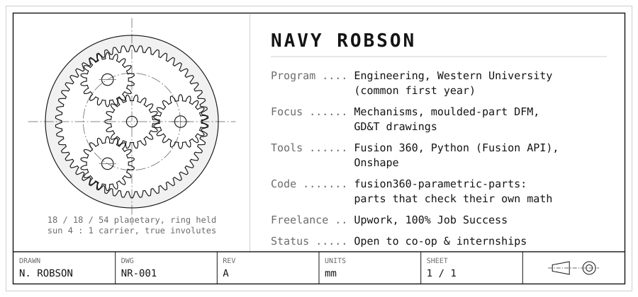

<picture>
  <source media="(prefers-color-scheme: dark)" srcset="assets/card-dark.svg">
  
</picture>

  <a href="https://www.linkedin.com/in/navy-robson">LinkedIn</a> &nbsp;·&nbsp;
  <a href="https://www.upwork.com/freelancers/navyrobson">Upwork</a> &nbsp;·&nbsp;
  <a href="https://github.com/nrobson3/fusion360-parametric-parts">fusion360-parametric-parts</a>

