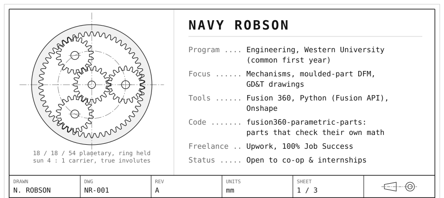
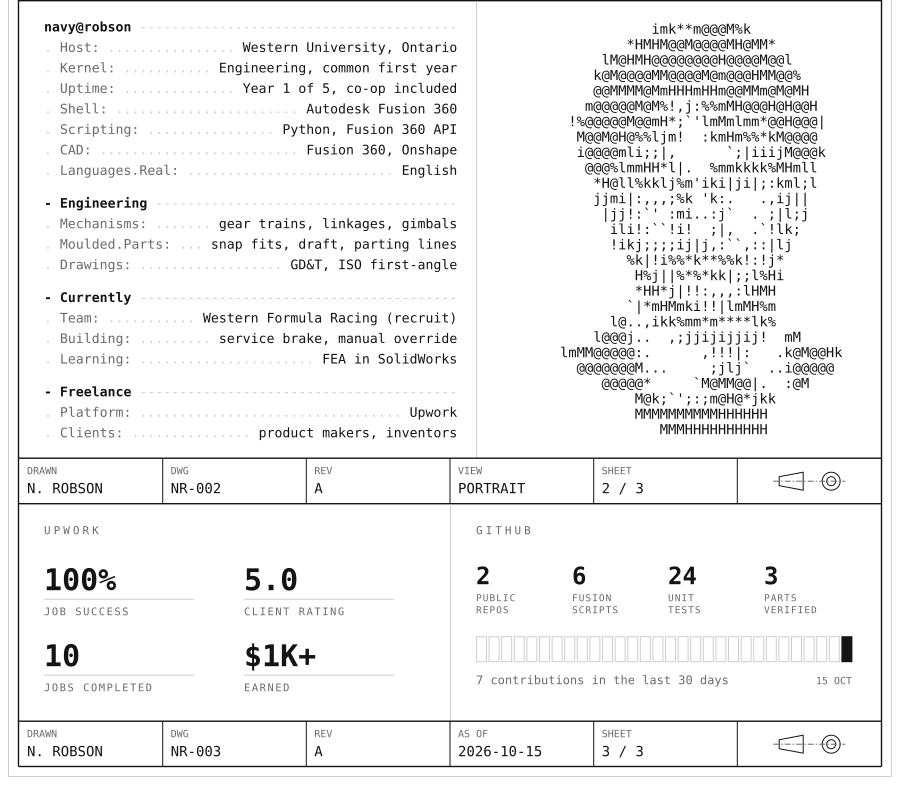

<picture><source media="(prefers-color-scheme: dark)" srcset="assets/profile-top-dark.svg"></picture><a href="https://www.linkedin.com/in/navy-robson"><picture><source media="(prefers-color-scheme: dark)" srcset="assets/link-linkedin-dark.svg"></picture></a><a href="https://www.upwork.com/freelancers/navyrobson"><picture><source media="(prefers-color-scheme: dark)" srcset="assets/link-upwork-dark.svg"></picture></a><a href="https://github.com/nrobson3/fusion360-parametric-parts"><picture><source media="(prefers-color-scheme: dark)" srcset="assets/link-code-dark.svg"></picture></a><picture><source media="(prefers-color-scheme: dark)" srcset="assets/profile-bottom-dark.svg"></picture>
